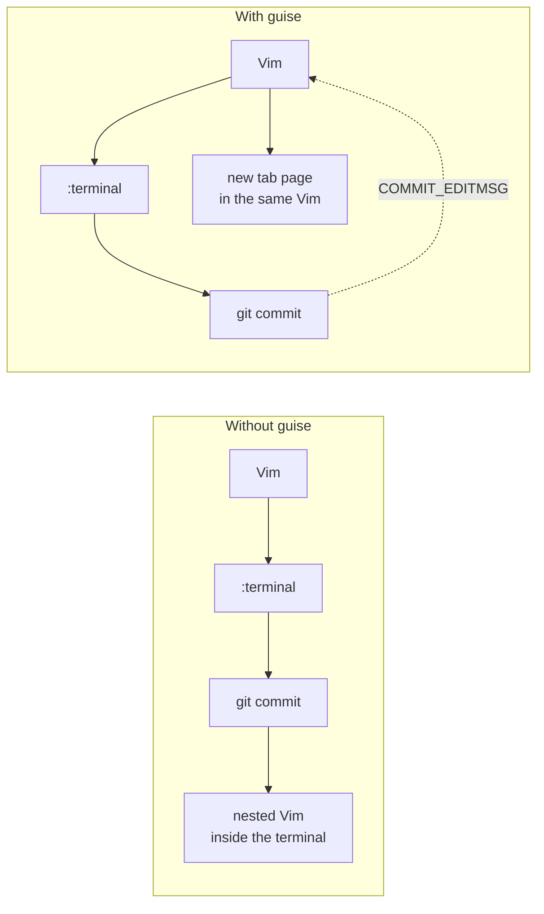
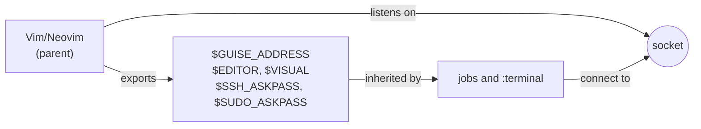
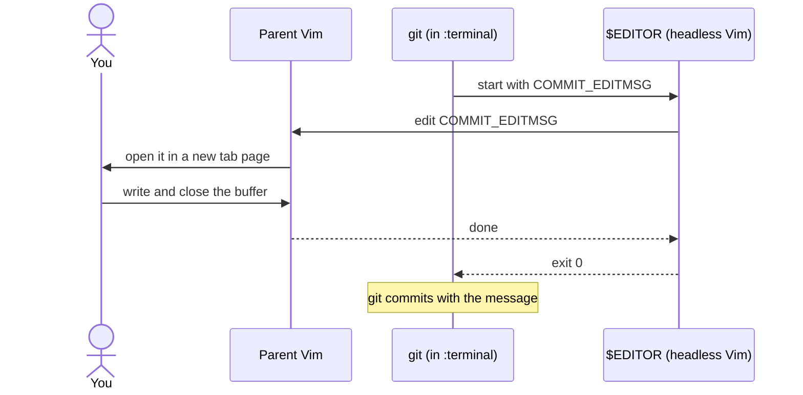
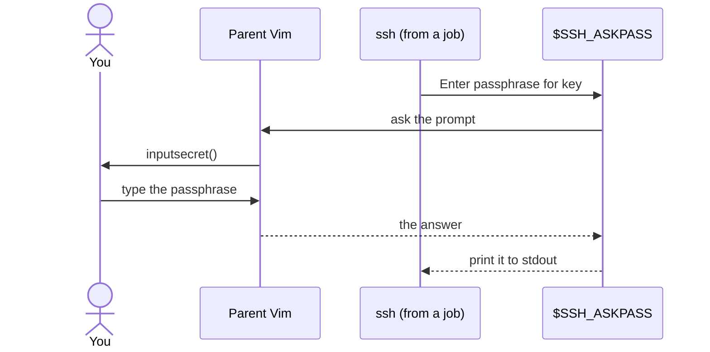
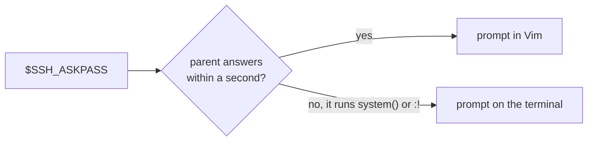
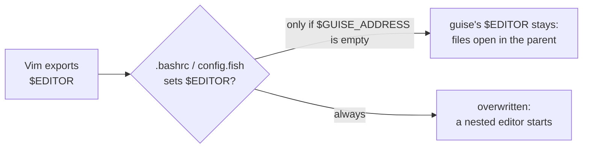

# 🎭 guise

[](https://github.com/vim/vim/tree/v9.2.0153)
[](https://github.com/neovim/neovim/tree/v0.10.0)
[](LICENSE)
[](doc/guise.txt)
[](https://github.com/lambdalisue/vim-guise/actions/workflows/test.yml)

Guise lets a program started from a job or terminal of Vim/Neovim open files
and ask for passwords in that instance, instead of starting a nested one.

## Why

Run `git commit` in `:terminal` and Git starts `$EDITOR` — a second Vim, drawn
inside the terminal window of the first. It has its own registers, buffers and
undo history, and none of your windows. A job has it worse: it has no terminal
at all, so neither an editor nor ssh asking for a passphrase can run.



With guise, the file opens in a new tab page of the Vim you are already in.
Git waits until you close it, then goes on as it would after any editor.

## How it works

On startup guise opens a channel server in the instance and exports variables
that point back to it. Every job and terminal started from the instance
inherits them.



### Editing a file

`$EDITOR` names a headless Vim/Neovim that forwards its arguments to the
parent and waits. A Vim or Neovim you start yourself in the terminal finds
`$GUISE_ADDRESS` and does the same, so `vim foo.txt` there opens `foo.txt` in
the parent too.



The buffer is wiped when it is closed, which tells the waiting program that
editing has finished.

### Answering a password prompt

`$SSH_ASKPASS` and `$SUDO_ASKPASS` name a program that asks the parent the
same way, and the parent prompts with `inputsecret()`. A job has no terminal to
type a passphrase into, so this is what lets `git push` over SSH or `sudo -A`
run from one.



While the parent waits for a command it started synchronously — `system()` or
`:!` — it cannot answer. The askpass program then asks on the terminal instead,
once the parent has not answered for a second.



## Requirements

- Vim 9.2.0153 or above (for `ch_listen()`), or Neovim 0.10.0 or above

Askpass is not exported on Windows.

## Installation

Install it with your plugin manager, e.g. [vim-plug](https://github.com/junegunn/vim-plug):

```vim
Plug 'lambdalisue/vim-guise'
```

or [lazy.nvim](https://github.com/folke/lazy.nvim):

```lua
{ 'lambdalisue/vim-guise' }
```

There is nothing to call. guise starts with the instance, unless Vim runs in
silent Ex mode (`-es`) or Neovim runs with `--headless`, where nobody could see
the tab page it opens.

## Shell configuration

A shell started in `:terminal` reads its startup files after it inherits the
variables. A startup file that assigns `$EDITOR` or `$VISUAL` unconditionally
replaces the editor guise exported, and programs in the terminal start a nested
editor again.



Assign the editor variables only when `$GUISE_ADDRESS` is empty:

```sh
# sh, bash, zsh
if [ -z "$GUISE_ADDRESS" ]; then
  export EDITOR=nvim
  export VISUAL="$EDITOR"
fi
```

```fish
# fish
if test -z "$GUISE_ADDRESS"
    set -gx EDITOR nvim
    set -gx VISUAL $EDITOR
end
```

A program-specific setting that names another editor, such as `$GIT_EDITOR`,
hides guise's `$EDITOR` in the same way; leave it unset or point it at
`$EDITOR`.

`:checkhealth guise` on Neovim and `:GuiseCheck` on Vim report whether your
shell keeps these variables. See `:help guise-shell`.

## Configuration

| Variable | Default | Effect |
| --- | --- | --- |
| `g:guise_edit_opener` | `"tab drop"` | command that opens a forwarded file |
| `g:guise#disable_editor` | `0` | leave `$EDITOR` and `$VISUAL` untouched |
| `g:guise#disable_askpass` | `0` | leave `$SSH_ASKPASS`, `$SUDO_ASKPASS` and `$SSH_ASKPASS_REQUIRE` untouched |
| `g:guise#disable_vim` | `0` | let a Vim started in the terminal run nested |
| `g:guise#disable_neovim` | `0` | let a Neovim started in the terminal run nested |

guise sets `$SSH_ASKPASS_REQUIRE` to `force` unless it is already set, because
ssh ignores `$SSH_ASKPASS` without `$DISPLAY` otherwise. See `:help guise` for
every option and the details of askpass.

guise replaces [lambdalisue/askpass.vim](https://github.com/lambdalisue/askpass.vim).

## Development

```sh
make test       # Vim and Neovim
make test-vim   # Vim only
make test-nvim  # Neovim only
```

## Similar projects

- [thinca/vim-singleton](https://github.com/thinca/vim-singleton)
- [lambdalisue/edita.vim](https://github.com/lambdalisue/edita.vim)
- [mhinz/neovim-remote](https://github.com/mhinz/neovim-remote)
- [kyoh86/vim-editerm](https://github.com/kyoh86/vim-editerm)
- https://qiita.com/tennashi/items/a1a7a08ceb69d2768158

## License

MIT. See [LICENSE](LICENSE). Contributions are accepted under the same license.
